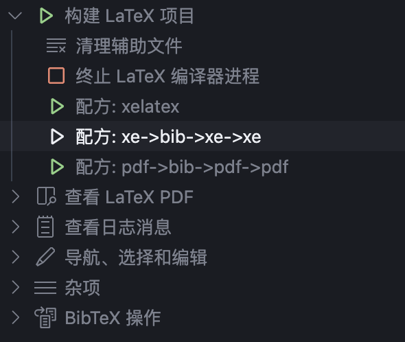

# 浙江大学Latex幻灯片模板

## News

该模板改编自 `ZJU-Beamer-Template`

```shell
git clone https://github.com/qychen2001/ZJU-Beamer-Template.git
```


## Quick Start

### Windows
1. 下载并安装 TeXLive（安装过程略）
2. 下载本模板文件(或者在Release中下载压缩包)
3. 在命令行中使用`XeLaTeX`编译

```shell
xelatex ZJU_BeamerTemplate.tex
bibtex ZJU_BeamerTemplate
xelatex ZJU_BeamerTemplate.tex
xelatex ZJU_BeamerTemplate.tex
```

4. 或者可以在VsCode中使用`LaTeX Workshop`插件编译，选择`XeLaTeX`编译器。



### Linux/Mac
1. 下载并安装 TeXLive（安装过程略）
2. 下载本模板文件(或者在Release中下载压缩包)
3. 编写 ```.tex``` 文件；
4. 使用`make`编译

```shell
make # 编译
```

```shell
make init   # 删除所有辅助文件以及图片
make clean  # 删除辅助文件
make help   # 显示帮助信息
```

5. 或者在命令行中使用`XeLaTeX`编译，或者使用`LaTeX Workshop`插件编译，选择`XeLaTeX`编译器。（详见上一部分[Windows](#windows)）